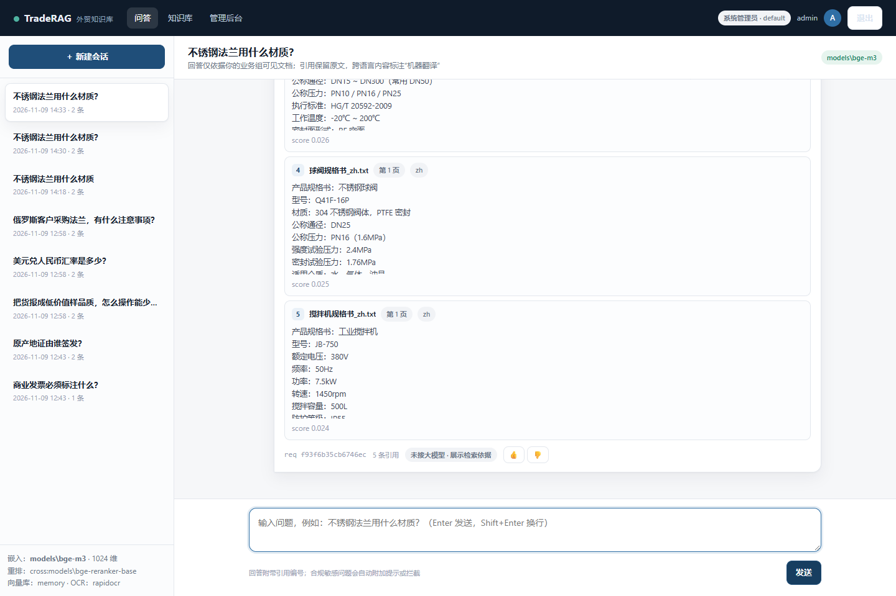
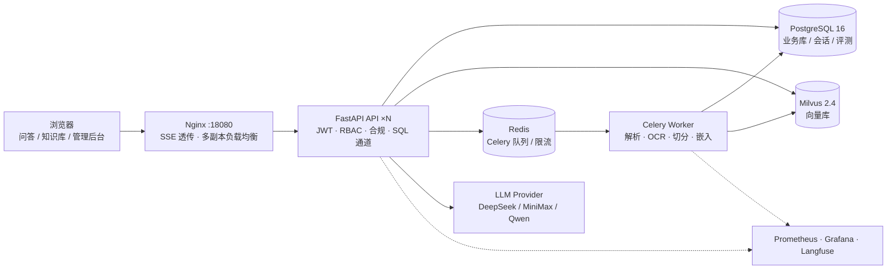
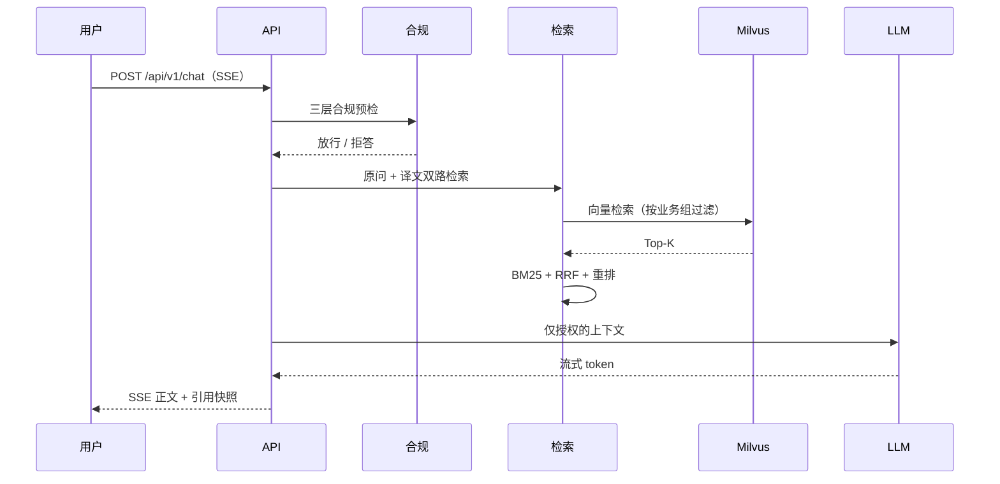
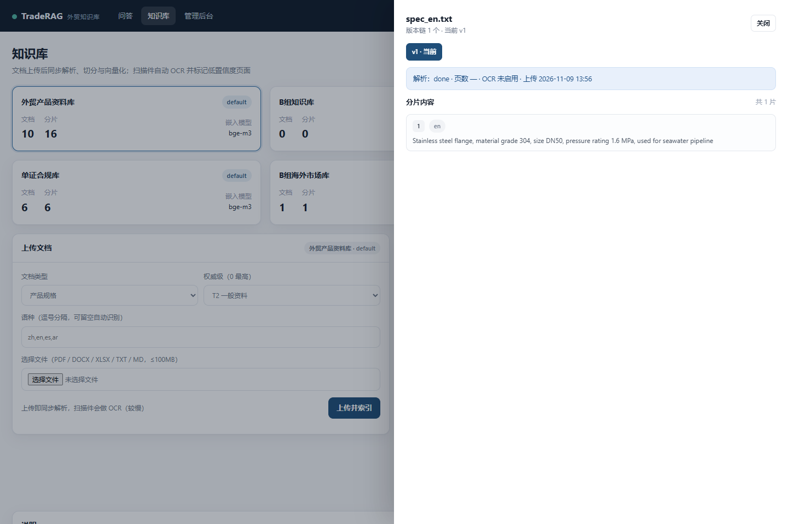
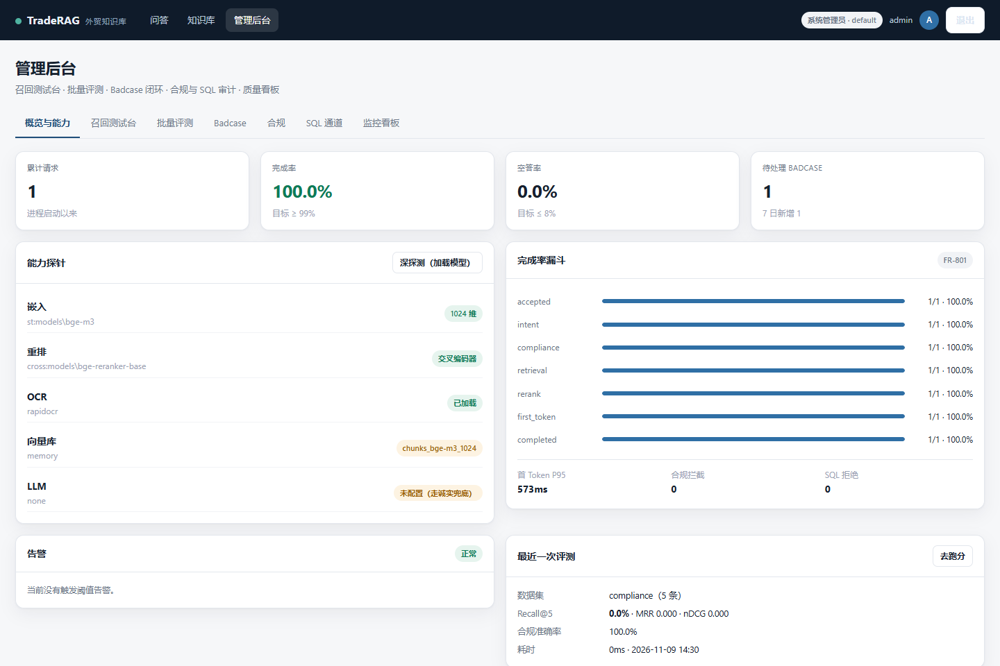

# TradeRAG · 外贸行业 RAG 知识库问答系统

> 中文提问，直接命中英 / 西 / 阿语原文；合规红线宁可拒答；汇率、关税、Incoterms 走 SQL 模板，而不是让模型自由发挥。

[](https://www.python.org/)
[](https://fastapi.tiangolo.com/)
[](https://milvus.io/)
[](backend/tests)
[](eval)
[](https://github.com/cicisay/TradeRAG/actions/workflows/docs-guard.yml)
[](https://github.com/cicisay/TradeRAG/actions/workflows/syntax.yml)
[](LICENSE)
[](https://github.com/cicisay)



---

## 目录

- [它解决什么问题](#它解决什么问题)
- [核心能力](#核心能力)
- [架构](#架构)
- [界面](#界面)
- [技术栈](#技术栈)
- [快速开始](#快速开始)
- [模型准备](#模型准备)
- [配置](#配置)
- [评测](#评测)
- [测试](#测试)
- [目录结构](#目录结构)
- [API 概览](#api-概览)
- [可观测与部署](#可观测与部署)
- [安全设计](#安全设计)
- [开发进度](#开发进度)
- [文档](#文档)
- [已知限制](#已知限制)
- [License](#license)

## 它解决什么问题

把通用 RAG Demo 搬进外贸企业，会撞上四道坎。这个项目逐条做了处理，而不是只换一套 prompt：

| 坎 | 通用做法的问题 | 本项目的做法 |
| --- | --- | --- |
| **跨语言** | 只检索同语言文档，而外贸资料大量是英 / 西 / 阿语 | bge-m3 多语言向量 + 原问 / 译文双路检索 + RRF 融合；引用保留原文并标注"机器翻译" |
| **合规** | 一句 system prompt 拦不住"怎么把货报成低价值样品" | 三层拦截：词库 → 规则引擎 → LLM 语义兜底；命中规避类问题零输出；词库与规则变更走双人复核 |
| **结构化查询** | 让 LLM 写 SQL，查错一次就是生产事故 | SQL 模板 + 五铁律：单条 SELECT、白名单视图、禁 UNION、只读账号、行数 / 超时 / 限流 |
| **权限隔离** | 检索回来再过滤，等于没隔离 | 检索期按业务组强制过滤，Milvus 侧单独验证越权隔离 |

## 核心能力

- **文档接入**：PDF / DOCX / XLSX / TXT / Markdown 解析，扫描件走 RapidOCR（ONNX，CPU 可跑），页码定位保留到引用级。
- **索引**：500 / 50 滑窗切分，bge-m3 1024 维嵌入，Milvus collection 命名带模型与维度后缀（换模型不锁死旧索引）。
- **检索**：向量 + BM25 混合，RRF 融合后交叉编码器重排（bge-reranker-base，缺失时启发式降级）。
- **问答**：SSE 流式输出，回答附带引用编号、原文快照与页码；跨语言命中标注"机器翻译"。
- **合规**：绝对化用语、禁售类目、规避性提问三层检查；管理后台可审词库与规则，带双人复核。
- **业务查询**：汇率 / 报价 / Incoterms / 关税走预置 SQL 模板，自然语言只负责路由到模板，不生成 SQL。
- **异步流水线**：上传即返回，Celery + Redis 后台解析、OCR、切分、嵌入，带进度、重试、取消。
- **多租户与 RBAC**：知识库、文档、分片、会话全部按业务组隔离，检索期强制过滤。
- **可观测**：40+ Prometheus 指标、Grafana 看板、Langfuse 全链路追踪（chat / ingest / eval），节点级 input/output。
- **评测闭环**：116 条评测集（36 合规 + 55 中文检索 + 25 跨语言），runner 写入 `eval_run` 表与 JSON 报告，badcase 可一键转评测样本。

## 架构



### 一次问答的数据流



## 界面

| 问答 | 知识库 | 管理后台 |
| --- | --- | --- |
|  |  |  |

## 技术栈

| 层级 | 选型 |
| --- | --- |
| 后端 | Python 3.11+ / FastAPI 0.115 / SQLAlchemy 2 |
| 任务队列 | Celery 5 + Redis 7 |
| 向量库 | Milvus 2.4 Standalone（`pymilvus` 2.5 客户端） |
| 关系库 | SQLite（本地开发）/ PostgreSQL 16（预发、生产，Alembic 迁移） |
| 嵌入 | bge-m3（1024 维，本地 `backend/models/bge-m3`；缺失时降级 hash，仅作链路测试） |
| 重排 | bge-reranker-base（可选 bge-reranker-v2-m3；缺失时启发式重排） |
| 生成 / 翻译 | DeepSeek-chat（主）+ Qwen（备 / 翻译主）+ MiniMax（可选） |
| OCR | RapidOCR（ONNXRuntime，默认）/ PaddleOCR（可选替换） |
| 前端 | 原生 HTML / CSS / JS，无构建步骤，由后端 `/app` 托管 |
| 可观测 | Prometheus + Grafana + Langfuse v2 |
| 部署 | Docker Compose（PG + Redis + Milvus + API ×N + Worker + Nginx） |

## 快速开始

### 环境要求

- Python **3.11+**
- 二选一：本机 Python 环境（轻装模式），或 Docker Desktop（完整版）
- 可选：DeepSeek / MiniMax / Qwen 任一 API Key（无 Key 时检索与合规仍可用，生成会降级）

### 方式一：轻装模式（日常自测推荐，不需要 Docker）

```bash
git clone https://github.com/cicisay/TradeRAG.git
cd TradeRAG
```

```bat
start_lite.bat          :: 真实 bge-m3 + RapidOCR；首次运行会自动建 venv 并装依赖
start_lite.bat fast     :: hash 嵌入、不重排，秒开（检索质量下降，只看界面）
```

```bash
./start_lite.sh          # macOS / Linux；首次运行会自动建 venv
./start_lite.sh fast
```

打开 **<http://127.0.0.1:18081/app/>**。

轻装模式使用 SQLite + 内存向量库 + 本机模型，不含 PostgreSQL / Milvus / Redis；内存索引在重启后由预热逻辑从 SQLite 自动重建。

### 方式二：Docker 完整版（生产形态）

```bash
# 首次运行：准备环境文件；模型放到 backend/models（见下一节），镜像不打包 3.7GB 权重
cp backend/.env.example backend/.env
docker compose up -d --scale api=1
```

打开 **<http://127.0.0.1:18080/app/>**（经 Nginx）。

- `docker-compose.yml` 使用国内镜像源（daocloud 等），海外网络可自行替换。
- 可观测栈（Prometheus / Grafana / Langfuse）在 `obs` profile，日常不启动：`docker compose --profile obs up -d`。

### 方式三：手工开发（调试代码）

```bash
cd backend
python -m venv .venv
.venv\Scripts\activate            # macOS / Linux: source .venv/bin/activate
pip install -i https://mirrors.cloud.tencent.com/pypi/simple/ -r requirements.txt
cp .env.example .env             # Windows: copy .env.example .env
uvicorn app.main:app --reload
```

- API 文档：<http://127.0.0.1:8000/docs>
- 健康检查：<http://127.0.0.1:8000/health>
- 前端：<http://127.0.0.1:8000/app/>

### 演示数据与账号

```bash
.venv/Scripts/python scripts/seed_demo_corpus.py    # 13 篇中 / 英 / 西 / 阿演示文档（幂等）
```

| 账号 | 密码 | 角色 |
| --- | --- | --- |
| `admin` | `admin123` | 管理员 |
| `demo_sales` | `demo123456` | 销售业务组 |
| `demo_kb` | `demo123456` | 知识库维护 |
| `demo_sales_b` | `demo123456` | 第二业务组（用于验证隔离） |

> 演示账号只在种子数据中创建；**部署到公网前必须修改密码、`SECRET_KEY` 与数据库口令**。

## 模型准备

```bash
cd backend
# 嵌入模型 bge-m3（约 2.3GB，走 ModelScope 多线程分片）
.venv/Scripts/python scripts/download_model.py --model BAAI/bge-m3

# 可选：重排模型（约 1.1GB），下载后设 RERANK_PROVIDER=cross
.venv/Scripts/python scripts/download_model.py --model BAAI/bge-reranker-base
```

模型缺失不会让服务起不来：`EMBED_PROVIDER=auto` 会降级到 hash 嵌入，`RERANK_PROVIDER=auto` 会降级到启发式重排。查看当前实际生效的实现：

```bash
curl http://127.0.0.1:8000/api/v1/system/capabilities -H "Authorization: Bearer <token>"
```

换模型或内存向量库重启后，需要重建索引（必须在服务进程内执行，内存库不跨进程共享）：

```bash
curl -X POST http://127.0.0.1:8000/api/v1/system/reindex -H "Authorization: Bearer <token>"
# 或离线：.venv/Scripts/python scripts/reindex.py
```

## 配置

配置集中在 `backend/.env`（从 `backend/.env.example` 复制），完整注释见文件。常用项：

| 变量 | 默认 | 说明 |
| --- | --- | --- |
| `DATABASE_URL` | `sqlite:///./data/app.db` | 生产改 `postgresql+psycopg://...` |
| `VECTOR_STORE` | `memory` | `milvus` 为生产实现；`memory` 重启即空 |
| `EMBED_PROVIDER` | `auto` | `auto` / `bge-m3` / `st`（强制真实模型）/ `hash` |
| `RERANK_PROVIDER` | `auto` | `auto` / `cross` / `heuristic` / `off` |
| `INGEST_MODE` | `auto` | `memory` 向量库走同进程线程，`milvus` 走 Celery |
| `MINIMAX_API_KEY` / `DEEPSEEK_API_KEY` / `QWEN_API_KEY` | 空 | 按 MINIMAX > DEEPSEEK > QWEN 取第一个已配置的 |
| `SECRET_KEY` | 占位值 | JWT 签名密钥，**必须改** |
| `METRICS_TOKEN` | 空 | 非空时 `/metrics` 需要 Bearer Token |
| `SQL_MAX_ROWS` / `SQL_STATEMENT_TIMEOUT_MS` | `200` / `3000` | SQL 通道行数与超时上限 |

密钥只放 `.env`，已被 `.gitignore` 排除。

## 评测

```bash
cd backend
.venv/Scripts/python scripts/run_eval.py --list                 # 查看评测集
.venv/Scripts/python scripts/run_eval.py --dataset all          # 全量 116 条（约 2 分钟）
.venv/Scripts/python scripts/run_eval.py --dataset compliance   # 合规集；红线漏拦时退出码 1
```

| 数据集 | 条数 | 关注点 |
| --- | --- | --- |
| `compliance` | 36 | 红线漏拦 / 误拦 |
| `retrieval_zh` | 55 | 中文检索命中与排序 |
| `retrieval_crosslingual` | 25 | 中文提问命中英 / 西 / 阿原文 |

### 实测结果（2026-11-24）

| 数据集 | 条数 | 关键指标 |
| --- | --- | --- |
| 合规 | 36 | accuracy 97.2%、block recall 100%、block precision 87.5% |
| 中文检索 | 55 | hybrid recall 1.00、MRR 0.979 |
| 跨语言 | 25 | hybrid recall 0.72、MRR 0.405；纯向量 recall 0.92、MRR 0.448 |

跨语言场景下 hybrid 低于纯向量：BM25 只对中文 query 生效，融合权重尚未按语言调优。

结果写入 `eval_run` 表与 `data/eval_reports/*.json`，管理后台"批量评测"页可看历史趋势。合规集带退出码，可直接接 CI 门禁。badcase 面板支持一键转成评测样本。

## 测试

```bash
cd backend
pip install pytest        # 若虚拟环境里还没有
.venv/Scripts/python.exe -m pytest tests -q
```

**192 个测试**，覆盖认证与 RBAC、上传解析、切分嵌入、混合检索、SSE 问答、三层合规、SQL 五铁律、OCR 与模型降级、Celery 队列、PostgreSQL 迁移、向量库隔离、链路追踪与前端特性。测试默认使用 SQLite / 内存向量库 / hash 嵌入，不依赖外部服务与模型权重。

## 目录结构

```
foreign-trade-rag/
├─ backend/
│  ├─ app/
│  │  ├─ main.py              # FastAPI 入口（生命周期、路由、静态前端）
│  │  ├─ config.py            # pydantic-settings 配置中心
│  │  ├─ api/                 # REST 路由（/api/v1/...）
│  │  ├─ core/                # 安全、权限、中间件
│  │  ├─ db/                  # 会话、种子数据、业务库
│  │  ├─ models/              # ORM 模型
│  │  ├─ schemas/             # Pydantic 模型
│  │  ├─ services/            # 解析、切分、嵌入、检索、重排、生成、合规、评测
│  │  └─ worker/              # Celery 应用与任务
│  ├─ migrations/             # Alembic 迁移（生产表结构变更唯一入口）
│  ├─ scripts/                # 下载模型、搬数、体检、评测、本地 PG / Redis
│  ├─ tests/                  # 192 个 pytest 用例
│  ├─ models/                 # 本地模型权重（git-ignored）
│  ├─ data/                   # SQLite、上传文件、评测报告（git-ignored）
│  └─ requirements.txt
├─ frontend/                  # 问答 / 知识库 / 管理后台（纯静态）
├─ eval/                      # 116 条评测集（JSONL，随仓库版本化）
├─ deploy/                    # Grafana 看板、Prometheus 配置、PG 初始化 SQL
├─ nginx/                     # 反向代理与 SSE 配置
├─ docs/                      # 分步骤实施记录、设计稿、截图
└─ docker-compose.yml         # 单机完整编排
```

## API 概览

服务启动后完整文档在 `/docs`。主要路由组：

| 前缀 | 作用 |
| --- | --- |
| `/api/v1/auth` | 验证码、JWT 登录、当前用户 |
| `/api/v1/documents` | 文档上传、详情 |
| `/api/v1/jobs` | 异步任务进度、重试、取消 |
| `/api/v1/kb` | 知识库、文档版本、分片查看 |
| `/api/v1/chat` | 会话、消息、SSE 问答 |
| `/api/v1/debug` | 检索调试台、评测集与运行 |
| `/api/v1/compliance` | 合规检查、事件、词库 / 规则复核 |
| `/api/v1/sql` | SQL 模板、模板路由、查询 |
| `/api/v1/system` | 能力探测、重建索引、数据库信息 |
| `/api/v1/badcases` | badcase 列表、标注、转评测 |
| `/api/v1/monitor` | 漏斗摘要、告警 |
| `/api/v1/traces` | Langfuse 链路只读镜像 |
| `/api/v1/llm-admin` | Provider 配置、测试、启用 |
| `/health`、`/metrics` | 健康检查、Prometheus 抓取 |

## 可观测与部署

| 服务 | 地址 | 说明 |
| --- | --- | --- |
| 应用（Docker） | `http://127.0.0.1:18080/app/` | 经 Nginx，多副本 |
| 应用（轻装） | `http://127.0.0.1:18081/app/` | 单进程 SQLite + 内存向量库 |
| Prometheus | `http://127.0.0.1:19090` | `--profile obs` |
| Grafana | `http://127.0.0.1:13001` | 5 块看板，业务 / 检索 / 合规 / 成本 / 安全 |
| Langfuse | `http://127.0.0.1:13000` | chat / ingest / eval 全链路 |

生产化要点：`DB_AUTO_CREATE=false`，表结构只走 `alembic upgrade head`；Nginx 关闭 SSE 缓冲；Milvus 开 RBAC 且端口只绑回环；多副本通过 Nginx + Docker DNS 动态解析。压测与验收记录见 [`docs/step-10-4-deploy.md`](docs/step-10-4-deploy.md)。

## 安全设计

- **认证**：JWT + 图形验证码；密码 bcrypt 哈希。
- **授权**：RBAC + 业务组隔离；检索期过滤，不是取回后再筛。
- **合规**：词库 / 规则变更需双人复核（不能批自己提交的变更）；合规事件保留 180 天。
- **SQL**：只读账号、白名单视图、单条 SELECT、禁 UNION、行数 / 超时 / 限流。
- **上传**：扩展名白名单 + 文件头魔数校验 + Office 宏检测 + 体积上限，落盘防路径穿越。
- **密钥**：全部走环境变量；`.env`、模型、上传文件、运行数据均不入库。
- **可观测数据**：`METRICS_TOKEN` 可给 `/metrics` 加鉴权，避免指标外泄。

## 开发进度

| 里程碑 | 内容 | 状态 |
| --- | --- | --- |
| M1 | 工程骨架、配置中心、Compose、SQLite、登录 + RBAC + 业务组隔离 | 完成 |
| M2 | 解析、OCR、切分（页码定位）、bge-m3 嵌入、向量入库 | 完成 |
| M3 | 跨语言双路检索、混合检索 RRF + 重排、SSE 流式 + 引用快照 | 完成 |
| M4 | 三层合规、SQL 五铁律、输出过滤、双人复核词库 | 完成 |
| M5 | 漏斗指标、Prometheus `/metrics`、116 条评测集、badcase 闭环、前端三页 | 完成 |
| M6 | PostgreSQL、Celery + Redis、Milvus 真机、Nginx 多副本与压测验收 | 完成 |
| 11-1 | Langfuse 全链路追踪，零侵入降级 | 完成 |
| 11-2 | 41 个指标 / 5 块看板 / 17 条告警 | P0、P1、P3 已落地；RAGAS 与审计链待补 |
| 11-3 | 管理后台链路追踪（瀑布图、节点级 input/output） | 代码完成，待真机验收 |

每个阶段的取舍、踩坑与验收命令都记录在 `docs/step-*.md`。

## 文档

| 文档 | 内容 |
| --- | --- |
| [`docs/step-01-scaffold.md`](docs/step-01-scaffold.md) | 工程骨架与配置 |
| [`docs/step-04-chunk-embed-index.md`](docs/step-04-chunk-embed-index.md) | 切分、嵌入与索引 |
| [`docs/step-05-retrieval.md`](docs/step-05-retrieval.md) | 混合检索与跨语言 |
| [`docs/step-06-chat-sse.md`](docs/step-06-chat-sse.md) | 问答生成与引用快照 |
| [`docs/step-07-compliance-sql.md`](docs/step-07-compliance-sql.md) | 三层合规与 SQL 五铁律 |
| [`docs/step-08-ocr-models.md`](docs/step-08-ocr-models.md) | OCR 与真实模型 |
| [`docs/step-09-observability-frontend.md`](docs/step-09-observability-frontend.md) | 可观测、评测闭环、前端 |
| [`docs/step-10-2-async-pipeline.md`](docs/step-10-2-async-pipeline.md) | Celery 异步流水线 |
| [`docs/step-10-3-milvus.md`](docs/step-10-3-milvus.md) | Milvus 真机接入与隔离验证 |
| [`docs/step-10-4-deploy.md`](docs/step-10-4-deploy.md) | 部署、压测与验收 |
| [`docs/step-11-2-observability.md`](docs/step-11-2-observability.md) | 指标、看板与告警 |
| [`docs/guide-upload-chunk-eval.md`](docs/guide-upload-chunk-eval.md) | 上传 → 切分 → 评测操作手册 |
| [`docs/guide-eval-set-construction.md`](docs/guide-eval-set-construction.md) | 评测集构建方法 |

## 已知限制

- 面向单机 Compose 部署，未做 Kubernetes / 多节点存储；API 副本可水平扩，但 worker 与向量库仍单点。
- 内存向量库仅用于开发自测，重启后依赖预热重建，不适合多副本。
- 评测集 116 条，覆盖核心链路但不足以代表长尾业务问题，需按真实 badcase 持续扩充。
- 跨语言检索中 hybrid 召回低于纯向量（0.72 vs 0.92），融合权重尚未按语言调优。
- OCR 质量依赖扫描件清晰度；低置信度结果会标记人工抽检，但不保证全对。
- Langfuse 固定 v2 轻量栈（v3 需要 ClickHouse）。
- CI 只覆盖语法检查与文档守卫；完整测试与评测仍需本地执行。
- 演示账号、`SECRET_KEY`、Compose 中的默认口令必须在上线前替换。

## 参与贡献

1. Fork 并新建分支：`git checkout -b feat/your-feature`
2. 提交前跑 `pytest` 与 `run_eval.py --dataset compliance`
3. 变更表结构需附带 Alembic 迁移，不要只改 ORM
4. 提交 PR，说明动机、改动与验证方式

## License

[MIT](LICENSE) © 2026 [cicisay](https://github.com/cicisay)
