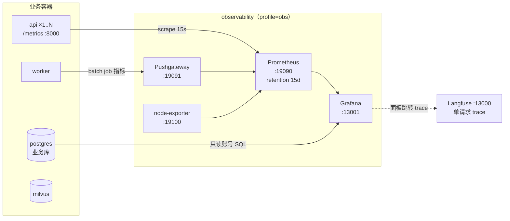

# 步骤 11-2：Prometheus + Grafana 指标与观测（方案设计）

> 目标：把"系统跑得好不好、答得准不准、知识库缺什么"变成**可看、可告警、可追责**的数字。
> 一句话结论：**不是所有指标都该进 Prometheus**。实时技术指标进 Prometheus（15s 粒度、能告警），
> 业务/知识库指标查 Postgres（分钟/天粒度），答案质量靠离线评测批次（版本粒度）。
> 三类在 Grafana 里汇总成 5 块看板，各看各的，不互相污染。

## 1. 先分清三类指标（决定用什么采）

| 类别 | 特征 | 载体 | 时效 | 清单里对应 |
|---|---|---|---|---|
| **A 实时技术/事件** | 高频、可累加、要告警 | Prometheus 抓 `/metrics` | 15s | 时延 P95、TTFT、错误率、并发、LLM 降级、资源水位 |
| **B 业务/运营** | 低频、要 join 业务表、看趋势 | Grafana → Postgres 只读 | 1~60min | 完成率、点赞率、活跃度、badcase 闭环、知识库存量 |
| **C 质量评测** | 批次产出、按版本对比 | `eval_run` 表 + Pushgateway | 每次变更 | 忠实度、相关性、Recall/MRR/NDCG、拒答准确率、幻觉率 |

**为什么不能全塞 Prometheus**：把 `user_id`、`query`、`doc_name` 做成标签会标签爆炸（基数上万），
Prometheus 内存和查询会直接崩；而"忠实度"根本不是时序数据，是"某一批 50 条样本的评测结论"。
反过来，把 P95 放在 PG 里算，每次查询都要全表扫，也撑不住。**分层是性能问题，也是口径问题。**

## 2. 现状盘点

### 2.1 已经有的

| 能力 | 位置 | 可用度 |
|---|---|---|
| `/metrics` 文本端点（Prometheus 格式） | `app/api/monitor.py` | 可用，可选 Bearer token |
| 漏斗 7 阶段计数（accepted→completed） | `app/services/metrics.py` | 可用，进程内计数 |
| 合规/ SQL / 回答质量 / 错误码计数 | 同上 | 可用 |
| 阶段耗时分位数 | 同上（deque 5000 样本算 p50/p95/p99 后当 gauge 暴露） | **只能看进程生命周期，不能算滑动窗口** |
| 全链路 trace（阶段/耗时/输入输出） | Langfuse（11-1） | 可用，按请求查 |
| 检索评测 Recall@K / MRR / NDCG（分通道） | `eval_run` 表 + `data/eval_reports/*.json` | 可用，需手动跑 |
| 合规评测 block precision / recall | 同上 | 可用 |
| 反馈表（up/down + 原因 + 快照） | `feedback` 表 | 可用 |
| badcase 表（状态/归因/trace_id/closed_at） | `badcase` 表 | 可用，闭环时长可算 |
| 引用快照（文档名/页码/原文） | `ref_snapshot` 表 | 可用，可溯源率可算 |
| 文档时效（effective/expire） | `document_meta` | 字段有，检索是否强制过滤需确认 |
| SQL 执行审计（只增） | `sql_exec_audit` | 可用 |
| 合规事件 | `compliance_event` | 可用 |

### 2.2 关键缺口（这份方案要补的）

| 缺口 | 卡住哪些指标 | 补法 | 工作量 |
|---|---|---|---|
| 没有 HTTP 层埋点（QPS/状态码/时延） | 错误率、可用性、P95、按接口拆解 | FastAPI 中间件 + Histogram | 0.5 天 |
| 分位数是 gauge（进程内样本算的） | 窗口 P95、多副本聚合、告警 | 换 `prometheus_client` Histogram，PromQL `histogram_quantile` | 0.5 天 |
| LLM token / TTFT / 降级次数没上报 | token 成本、首字、切家率 | 流式末帧取 usage + generation 埋点（依赖 11-1 套餐 A） | 0.5 天 |
| 没有并发数、SSE 断开率 | 按并发会话建模、突刺 | Gauge + 断开计数 | 0.2 天 |
| 没有 Prometheus / Grafana 本体 | 所有面板与告警 | compose 增 3 个服务（profile=obs） | 0.5 天 |
| 质量指标只有检索三项 | 忠实度/相关性/上下文精确率/拒答准确率 | 接 RAGAS 离线跑批 + 人工抽检 | 1 天 |
| 反馈/降级/越权没有计数器 | 点踩率告警、RBAC 拦截率 | 在 feedback、403 处理、降级分支各加一行 | 0.3 天 |
| 没有通用审计表 | 审计覆盖率、不可篡改 | 新建 `audit_log`（追加写 + 哈希链） | 1 天（可延后） |
| 无语义缓存 | 语义缓存命中率 | 当前只有翻译/模型配置缓存，**该指标暂不存在** | — |

## 3. 架构



| 组件 | 镜像（DaoCloud 源） | 内存 | 端口（仅回环） | 用途 |
|---|---|---|---|---|
| Prometheus | `prom/prometheus:v2.54.1` | ~100MB | 19090 | 抓取 + 告警规则 |
| Grafana | `grafana/grafana:11.2.0` | ~180MB | 13001 | 5 块看板 |
| Pushgateway | `prom/pushgateway:v1.9.0` | ~20MB | 19091 | 离线评测/批任务指标 |
| node-exporter | `prom/node-exporter:v1.8.2` | ~15MB | 19100 | 宿主机 CPU/内存/磁盘 |

合计 **实测约 150MB**（Prometheus 89MB + Grafana 49MB + node-exporter 10MB），
全栈从 1.9GB → 2.18GB / 7.65GB，比预算的 315MB 还省。不装 cAdvisor（容器级资源用 `docker stats` 足够）。

**多副本抓取**：`--scale api=2` 时服务名 `api` 会解析出多个 A 记录，Prometheus 用
`dns_sd_configs: [{names: ["api"], type: A, port: 8000}]` 即可抓到每个副本，各自算完再由 PromQL 聚合——
不要试图让副本共享计数器。

**抓取鉴权**：`backend/.env` 里配 `METRICS_TOKEN`，Prometheus 侧 `bearer_token_file` 读取；本机自用可留空。

## 4. 指标契约（六大类，逐条给口径）

> 命名规范：计数器 `_total`、时长 `_seconds`、直方图带 `_bucket`；单位一律秒/字节/个。
> **红线：`query`、`user_id`、`doc_name`、`session_id` 一律不进标签**——要追具体请求去 Langfuse 按 request_id 查。

### 4.1 技术指标（Prometheus，P0）

| 指标 | 类型 | 标签 | 口径 |
|---|---|---|---|
| `rag_http_requests_total` | counter | method, route, status | route 用模板路径（`/api/v1/chat`），不用原始 URL |
| `rag_http_request_duration_seconds` | histogram | method, route | 端到端；桶 0.1/0.3/1/3/5/10/30/60 |
| `rag_http_inflight` | gauge | — | 当前处理中请求数（=并发会话近似值） |
| `rag_chat_stage_duration_seconds` | histogram | stage | 阶段= intent/compliance/retrieval/generation/output |
| `rag_ttft_seconds` | histogram | provider, model | 首 token；仅文本通道 |
| `rag_chat_total` | counter | intent, result | result=completed/refused/blocked/empty/error/aborted |
| `rag_llm_calls_total` | counter | mode, provider, model, outcome | mode=stream/once；outcome=ok/error（被切掉的那家也记 error，反映厂商可用性） |
| `rag_llm_tokens_total` | counter | kind, provider, model | kind=prompt/completion/**reasoning**/total；reasoning 是推理模型的思考 token，单独记才能解释成本与首字 |
| `rag_llm_usage_missing_total` | counter | provider, mode | 厂商未返回 usage 的次数（接口兼容性哨兵，应恒为 0） |
| `rag_degraded_total` | counter | reason | 降级分布：translation_unavailable / llm_fallback / sql_fallback / rerank_skipped |
| `rag_retrieval_hits_count` | histogram | channel | 每路命中条数；桶 0/1/3/5/10/20 |
| `rag_retrieval_duration_seconds` | histogram | channel | vector/bm25/variant/rerank/fuse |
| `rag_retrieval_degraded_total` | counter | reason | 翻译失败/向量不可用/SQL 降级 |
| `rag_sse_disconnect_total` | counter | phase | 客户端中途断开 |
| `rag_feedback_total` | counter | rating | up/down（业务比率仍以 PG 为准，这里只做实时告警） |
| `rag_compliance_total` | counter | action, layer | pass/annotate/block × 词库/规则/输出 |
| `rag_rbac_denied_total` | counter | resource | 403 越权拦截 |
| `process_resident_memory_bytes` 等 | 官方自带 | — | 用 `prometheus_client` 默认进程指标 |

**逐阶段时延预算**（写进看板，告警按"超预算"而不是拍脑袋）：

| 阶段 | 预算 P95 | 依据 |
|---|---|---|
| 合规预检 | ≤ 100ms | 词库+规则，纯内存 |
| 检索（含变体+重排） | ≤ 4s | 本机 CPU bge-m3 + reranker 实测 9s，需先优化翻译并发 |
| 生成 TTFT | ≤ 2.5s | PRD FR-209 |
| 生成完成 | ≤ 15s | 300~400 字答案 |
| 端到端 P95 | ≤ 15s | 纯文本口径（当前 15.5s，踩线） |

### 4.2 业务与运营指标（Grafana → Postgres，P1）

| 指标 | 口径（分子 / 分母） | 数据源 |
|---|---|---|
| 问答完成率 | `assistant 消息中 content 非空` / `(会话请求数 − 客户端中断数)` | `message` + `rag_chat_total{result="aborted"}` |
| 分通道完成率 | **当前只有文本通道**；`voice/image` 只预留 label，无数据 | 产品无入口，见 §8 |
| 点赞率 / 点踩率 | `rating='up'` / 总反馈；`rating='down'` / 总反馈 | `feedback` |
| 转人工率（代理） | `(拒答 + 空答 + 点踩)` / 总回答；**无人工坐席，只能代理** | `message` + `feedback` |
| 问题解决率（代理） | `(1 − 点踩率 − 拒答率)`，样本 ≥30/周才出结论 | 同上 |
| 日活 / 周活 | `count(distinct user_id)` by day / 7d | `message` → `session.user_id` |
| 人均提问次数 | 提问数 / 活跃用户数 | `message` |
| 问题重复率 | 归一化（去空格/标点/大小写）后重复 query 数 / 总 query 数 | `message`（可选 embedding 聚类） |
| 响应时长中位数 | `message.created_at` 与上一条 user 消息的时间差 | `message` |
| 覆盖业务场景数 | `document_meta.doc_type` 去重计数 | `document_meta` |

> **"节省人工工时/ROI"不在技术指标内**：需要业务侧基线（原来每单咨询耗时 × 自助解决量）。
> 技术侧只提供"响应时长"和"自助解决率"，ROI 由业务方套公式，避免自证。

### 4.3 答案质量指标（离线批次，P2）

| 指标 | 口径 | 采集方式 | 现状 |
|---|---|---|---|
| 可溯源率 | `带 ref_snapshot 的 assistant 消息` / `总 assistant 消息`，目标 100% | PG 直查，实时可算 | **今天就能做** |
| 引用位置完整率 | `page_or_section 非空` / 带引用的消息 | PG 直查 | 今天就能做 |
| 忠实度 Faithfulness | RAGAS：答案断言能否被证据支撑（0~1） | 离线跑批 50 条/次 | 未实现 |
| 答案相关性 | RAGAS answer_relevancy | 同上 | 未实现 |
| 上下文精确率 | 送入 LLM 的 chunks 中相关 chunk 占比 | 复用评测集标注 | 未实现 |
| 拒答准确率 | 知识库外问题中正确拒答的比例（需 30 条拒答集） | 离线 | 未实现（拒答逻辑有，测试集无） |
| 幻觉率 | 人工抽检中"事实错误/无依据"条数 / 抽检条数，抽检 ≥20% | 人工 + RAGAS 交叉 | 未实现 |
| 合规拦截准确率 | 已实现 block precision/recall | `eval_run` | 已有 |

**成本估算**：50 条 × 4 指标，用 DeepSeek 跑 RAGAS 约 15 万 token，**单批 <1 元**；每周一批，成本可忽略。
**方法学红线**：LLM-as-Judge 有位置/长度偏差，必须人工抽检 ≥20% 校准；样本 <30 条只报数不下结论。

### 4.4 检索质量指标（调优期核心，P2）

| 指标 | 口径 | 现状 |
|---|---|---|
| Hit Rate / Recall@K | 正确文档是否进 Top-K | `eval_run.recall` 已有 |
| MRR | 第一个正确结果的排名倒数 | `eval_run.mrr` 已有 |
| NDCG@K | 排序质量（分级相关） | `eval_run.ndcg` 已有 |
| 通道对比 | 向量 / BM25 / 混合 / 变体四路分别跑 | 报告里分通道已有；**SQL 通道不是检索通道，要单列** |
| 上下文精确率 | 见 4.3 | 待补 |
| 0 命中率 | `rag_retrieval_hits_count` 中 0 命中的比例 | 待埋点（P0 顺带） |
| 过期文档召回数 | 召回结果中 `expire_date < today` 的条数，应恒为 0 | 待确认过滤是否强制 |

> 现有报告里 `vector.recall = 0.0`、`bm25 = 1.0`，这个基线**不可信**（向量路当时有字段口径问题），
> 上 Grafana 前必须先用当前代码重跑一次，否则趋势图从第一天就是错的。

### 4.5 知识库运营指标（PG 盘点 → Gauge → Prometheus，P3）

> **实现与最初方案的偏差**：原计划 Grafana 用 `ragpg` 只读账号直连查询；
> 实际落地改为 `monitor.py` 的后台桥接线程每 30s 把 PG 存量算成 Gauge，
> 再由 Prometheus 拉取。理由：①看板只维护一套 PromQL，不需要两套查询语法；
> ②多副本各自刷新、`sum` 聚合即可；③Grafana 不必持有数据库凭据。
> `ragpg` 数据源仍保留，供临时 ad-hoc SQL 排查用，但**没有面板依赖它**。

| 指标 | 口径 | 数据源 |
|---|---|---|
| 文档入库量 / 更新频率 | 按天 `count(document)`、`count(doc_version)` | `document`/`doc_version` |
| 过期文档数 | `expire_date < today` 且状态 active | `document_meta` |
| 版本冲突数 | 同一 doc 多个 version 且都被检索命中 | `doc_version` + 检索日志 |
| 评测集规模 / 回归通过率 | 用例数；最近一次 `eval_run` 是否达阈值 | `eval_run` |
| badcase 积压 | `status='pending'` 计数，>20 告警 | `badcase` |
| badcase 闭环时长 | `avg(closed_at − created_at)`，按归因分组 | `badcase` |
| 点踩自动入库率 | `有 feedback 且生成 badcase` / `所有 down`，目标 100% | `feedback` ⟕ `badcase` |

### 4.6 安全合规指标（P1/P4）

| 指标 | 口径 | 现状 |
|---|---|---|
| 越权拦截率 | 403 次数 / 总请求；按资源维度 | 待埋点（中间件按状态码+路由） |
| 提示词注入拦截率 | 合规词库中注入类规则的 block 数 / 注入测试集条数 | 词库有，专项测试集无 |
| PII 脱敏率 | 脱敏字段数 / 应脱敏字段数 | **无系统化脱敏模块**，只有局部处理 |
| 数据出域合规 | 云 API 调用量 / 总调用量（本地模型占比） | 可从 `rag_llm_requests_total{provider}` 算 |
| 审计覆盖率 | 关键操作（登录/上传/删除/改配置/查数据）写审计的比例 | 仅 SQL/合规有审计，**缺通用审计表** |
| 审计不可篡改 | 追加写 + 哈希链（prev_hash） | 未实现 |

## 5. 看板（5 块，对应 5 类读者）

| 看板 | 读者 | 核心 panels | 数据源 | 刷新 |
|---|---|---|---|---|
| **业务运营** | 业务方/管理层 | 完成率、点踩率趋势、日活/周活、人均提问、Top10 未解决问题、代理转人工率 | PG | 5min |
| **答案质量** | 产品/QA | 可溯源率、引用位置完整率、RAGAS 四指标趋势（带版本竖线）、人工抽检幻觉率、拒答准确率 | PG + Pushgateway | 1h |
| **检索调优** | 算法 | 四通道 Recall/MRR/NDCG 对比、上下文精确率、0 命中率、Top 漏召案例表 | PG + Prometheus | 15min |
| **系统运维** | 运维/开发 | RED 三件套、TTFT、阶段时延瀑布（vs 预算）、并发、LLM 切家、资源水位 | Prometheus | 15s |
| **知识库与安全** | 知识管理员/合规 | 入库量、过期文档、badcase 积压与闭环时长、越权拦截、注入拦截、云 API 占比 | PG + Prometheus | 5min |

Grafana 用 provisioning 自动装配：`deploy/grafana/datasources.yml`（Prometheus + PG 只读）、
`deploy/grafana/dashboards/*.json`（5 个 JSON 入库，改完提交即可复现）。

**PG 只读账号**（不给 Grafana 业务写权限）：

```sql
CREATE ROLE grafana_ro LOGIN PASSWORD '<强密码>';
GRANT CONNECT ON DATABASE rag TO grafana_ro;
GRANT USAGE ON SCHEMA public TO grafana_ro;
GRANT SELECT ON ALL TABLES IN SCHEMA public TO grafana_ro;
ALTER DEFAULT PRIVILEGES IN SCHEMA public GRANT SELECT ON TABLES TO grafana_ro;
```

## 6. 告警规则

| 规则 | 表达式（简写） | 阈值/持续 | 级别 |
|---|---|---|---|
| 端到端 P95 超预算 | `histogram_quantile(0.95, sum by(le)(rate(rag_http_request_duration_seconds_bucket{route="/api/v1/chat"}[5m])))` | >15s / 10m | P2 |
| TTFT P95 超预算 | `histogram_quantile(0.95, ...rag_ttft_seconds_bucket[10m])` | >5s / 10m | P2 |
| 5xx 比例 | `sum(rate(rag_http_requests_total{status=~"5.."}[5m])) / sum(rate(rag_http_requests_total[5m]))` | >1% / 5m | P1 |
| LLM 降级率 | `rate(rag_llm_requests_total{result=~"rate_limited\|server_error\|timeout"}[10m]) / rate(rag_llm_requests_total[10m])` | >10% / 10m | P1 |
| 检索 0 命中率 | `rate(rag_retrieval_hits_count_bucket{le="0"}[15m]) / rate(rag_retrieval_hits_count_count[15m])` | >5% / 15m | P2 |
| 点踩率 | `increase(rag_feedback_total{rating="down"}[1h]) / increase(rag_feedback_total[1h])` | >20% **且样本≥30** / 1h | P2 |
| badcase 积压 | Grafana 告警（PG）：`count(*) where status='pending'` | >20 / 30m | P3 |
| 资源水位 | `node_memory_MemAvailable_bytes / node_memory_MemTotal_bytes` | <15% / 10m | P2 |

小样本保护：点踩率必须带 `and increase(...[1h]) >= 30`，否则早上 3 条反馈里 1 条点踩就触发 33%，会把人叫醒。
通知渠道：先只接站内通知/邮件；Prometheus Alertmanager 暂不引入（单机没必要多一个组件）。

## 7. 实施计划（每一步可停）

| 阶段 | 内容 | 产出 | 预估 |
|---|---|---|---|
| **P0 底座** ✅ | `prometheus_client` 替换自研计数（保留 `/metrics` 路径与旧指标名 1 个版本）；HTTP 中间件；4 个直方图；compose 加 Prometheus/Grafana/node-exporter；运维看板 + 5 条基础告警 | 能看 QPS/错误率/P95/TTFT/阶段耗时 | 1 天（已完成） |
| **P1 事件埋点** ✅ | LLM token/切家、反馈计数、403 拦截、合规分级；业务看板（完成率/点赞率/活跃） | 业务+运维两块看板可交付 | 0.5 天（已完成，SSE 断开未做） |
| **P2 质量闭环** 🟡 | eval → Gauge；引用覆盖率；RAGAS 四指标跑批（含人工抽检模板）；检索调优看板 | 质量/检索两块看板 | 1 天（看板已出，**RAGAS 与忠实度/相关性未接**） |
| **P3 知识库运营** ✅ | PG 盘点 → Gauge（入库/过期/版本冲突/badcase 闭环）；badcase 积压告警 | 知识库看板 | 0.5 天（已完成） |
| **P4 安全与容灾** 🟡 | 拦截类已做（rbac/词库/规则/llm 四类 + 合规分层）；**PII 埋点、通用审计表、RTO 演练未做** | 安全看板 + 演练记录 | 1 天（部分完成） |

合计 **3~4 天**；P0 做完就已经能回答"现在慢不慢、错没错"，后面是逐步补齐业务与质量口径。

**每阶段验收**：
- P0：制造一次 500 错误和一次慢请求，看板 1 分钟内变色，点进 trace 能定位。
- P1：连续 10 次问答（5 赞 5 踩），点踩率面板显示 50%，badcase 自动 5 条。
- P2：跑一次评测，看板出现带版本标记的数据点，趋势可对比上一版。
- P3：过期一篇文档，看板"过期文档数"+1。

### 7.1 P0 已落地（2026-11-16）

**改了哪些代码**

| 文件 | 改动 |
|---|---|
| `backend/app/services/metrics.py` | 底层换 `prometheus_client`，新增 HTTP/阶段/TTFT/检索命中 7 个指标；旧接口与旧指标名保留一版 |
| `backend/app/core/middleware.py` | 新增纯 ASGI 指标中间件（不影响 SSE 流式），按路由模板打标签 |
| `backend/app/main.py` | 挂载中间件 |
| `backend/app/services/chat.py` | 补 compliance / generation / compliance_output 三段耗时 |
| `backend/app/services/retrieval.py` | 四个通道的命中条数、0 命中计数 |
| `backend/requirements.txt` | `prometheus-client==0.21.0` |
| `backend/Dockerfile` | pip 源改清华镜像 + 重试 5 次（见 §7.2 踩坑） |
| `docker-compose.yml` | prometheus / grafana / node-exporter 三个 obs 服务 + 两个数据卷 |
| `deploy/prometheus/*.yml` | 抓取配置（dns_sd 多副本）+ 5 条告警 |
| `deploy/grafana/**` | 数据源、看板自动装配；运维看板 9 个 panel（11-16 晚随 token 面板增至 13 个） |
| `deploy/postgres/init-grafana-ro.sql` | 只读账号（新卷自动执行，老卷手动跑一次） |

**启动**

```bash
docker compose --profile obs up -d prometheus grafana node-exporter
# Prometheus :19090   Grafana :13001（admin / rag-grafana-2026）
# 看板：Dashboards → RAG → "RAG 系统运维（P0）"
```

已有数据卷的环境，只读账号手动建一次：

```bash
docker exec -i foreign-trade-rag-postgres-1 psql -U rag -d rag -v ON_ERROR_STOP=1 \
  < deploy/postgres/init-grafana-ro.sql
```

**验收结果（真机）**

| 项 | 结果 |
|---|---|
| 抓取目标 | rag-api / node / prometheus 三个 `up=1` |
| `rag_http_requests_total` | 登录 2 次 + 问答 2 次，路由模板正确（无原始 URL） |
| 问答 P95（窗口） | 19.5s（两次冷启动问答，含 3.4s 输出合规） |
| TTFT P95 | 19.25s（MiniMax 推理模型，印证 11-1 的结论） |
| 阶段直方图 | compliance / retrieval / first_token / generation / compliance_output 均有样本 |
| 检索通道 | vector / bm25 / variant / hybrid 四路计数齐全；0 命中序列预置为 0（避免告警 no-data） |
| Grafana 数据源 | Prometheus `OK`、RAG-PG `Database Connection OK` |
| 进程指标 | 自带 `process_resident_memory_bytes`（api 实测 3.1GB 虚拟包含 mmap，docker stats 显示 1.19GB） |

**踩坑（P0 新增）**

1. **容器内 `pip install` 连 pypi.org 会 TLS 中断**：重试 5 次后仍失败（33 分钟白跑）。
   已把 Dockerfile 默认源改清华镜像并加 `--retries 5 --timeout 120`；
   需要官方源时 `docker build --build-arg PIP_INDEX=https://pypi.org/simple`。
2. **Docker Desktop(Windows) 不支持 `rslave` 传播挂载**：node-exporter 用 `/:/host:ro,rslave`
   会直接报 "not a shared or slave mount"，去掉 `rslave` 即可。
3. **node-exporter 的"宿主机"是 WSL2 虚拟机**：面板里的内存/CPU 是 Docker VM 的，
   不是 Windows 真实值；看 Windows 内存请用任务管理器。
4. **多副本别指望 IP 不变**：用 `dns_sd_configs` 自动发现，重启容器后 30s 内自动跟上。

### 7.2 P1 token 用量已落地（2026-11-16 晚）

**问题**：`llm.py` 的流式请求没带 `stream_options.include_usage`，也从不解析 usage。
后果是 token、成本、Langfuse 的原生 TTFT 字段三样全空——前面所有"慢不慢"能答，"贵不贵"答不了。

**改法**

| 文件 | 改动 |
|---|---|
| `llm.py` | `_stream_raw` 请求带 `stream_options.include_usage`；解析末帧 usage（该帧 `choices` 是空数组，旧代码会当异常帧丢掉）；新增 `on_usage` 回调；`chat_once` 取非流式 usage；厂商回 400/422 且 body 提到 `stream_options` 时自动去掉该字段重试一次，并记入 `_NO_USAGE_HOSTS` |
| `metrics.py` | 新增 `rag_llm_tokens_total{kind,provider,model}`（prompt/completion/**reasoning**/total）、`rag_llm_calls_total{mode,provider,model,outcome}`、`rag_llm_usage_missing_total` |
| `chat.py` | 回调收集 usage → `gen.close(usage=..., completion_start_time=...)`；实际出力的 model 写回 generation（切家后不再是 primary） |
| `deploy/grafana/dashboards/rag-ops.json` | 加 4 个面板：token 速率、平均每次调用 token、厂商占比（donut）、usage 缺失哨兵 |

**实测（一次真实问答，MiniMax 主用）**

| 项 | 数值 |
|---|---|
| 主调用（stream） | input 833 / output 582 / total 1415，其中 reasoning 约 400 |
| 翻译 3 次 + 输出合规 1 次（once） | 合计 1654 token / 4 次调用 |
| 单次问答全部 LLM 开销 | **3069 token / 5 次调用** |
| Langfuse generation | `usage={input:833, output:582, total:1415}`，`completionStartTime` 不再为 null |
| 兼容性 | MiniMax / DeepSeek 均支持 `stream_options`，`rag_llm_usage_missing_total=0` |

**两条口径提醒**

1. **别用 `rate(tokens)/rate(calls)` 算平均**：进程刚启动时各计数器创建时刻不同，
   `rate()` 对每条序列的外推不一致，实测算出 1894，真值 614（偏差 3 倍）。
   面板改成累计值相除（`sum(tokens)/sum(calls)`），进程重启后从 0 重新累计。
2. **reasoning 是 completion 的子集**：算总成本用 `kind="total"`，别把 reasoning 再加一遍。


## 8. 做不到 / 需要产品先补的（诚实边界）

1. **语音/图片通道**：产品当前只有文本问答入口，`channel` 标签只能预留，**不能伪造数据**。
2. **转人工率**：没有人工坐席/工单系统，只能用"拒答+空答+点踩"做**代理指标**，报表上必须标注"代理"。
3. **ROI / 节省工时**：属于业务测算，技术侧给响应时长与自助解决率，公式由业务方定。
4. **幻觉率 / 忠实度**：必须人工抽检校准；样本 <30 条不下结论，避免"1 条错=100% 幻觉"。
5. **审计不可篡改**：现在只有 `sql_exec_audit`/`compliance_event` 是只增表，缺通用审计与哈希链。
6. **RTO/RPO**：是流程与演练结果，不是采集指标；需要备份恢复脚本 + 季度演练记录。
7. **语义缓存命中率**：当前没有语义缓存，指标无从谈起（要做先做缓存，别先做面板）。
8. **通道对比里的 SQL**：SQL 是结构化查询通道，不是检索通道，混在召回率里会误导，必须单列"SQL 命中率"。

## 9. 需要拍板的 5 个决策

| 决策 | 选项 | 建议 | 理由 |
|---|---|---|---|
| 指标库 | 继续自研 / 换 `prometheus_client` | **换** | 自研只有 gauge 分位数，算不了窗口 P95、多副本聚合，Grafana 面板会失真 |
| 部署档位 | 轻量（Prom+Grafana+Push，315MB）/ 完整（+cAdvisor，+50MB） | **轻量** | 容器资源用 `docker stats` 够用，省内存 |
| Grafana 直连 PG | 是 / 否（桥接线程刷 Gauge） | **否**，改桥接 | 实测选了桥接：看板只需一套 PromQL、多副本可聚合、Grafana 不持库凭据；代价是存量最多滞后 30s |
| 质量评测 | 只人工 / RAGAS + 人工抽检 | **RAGAS + 20% 人工** | 单批 <1 元，能进回归；但纯 Judge 有偏差，必须人工校准 |
| 数据保留 | 15 天 / 30 天 | **15 天** | 本机磁盘有限；长期趋势看 `eval_run` 与周报快照 |

P0 已按建议执行：①已换 `prometheus_client`；②已用轻量档（实测 150MB）；
③改为桥接线程刷 Gauge（`ragpg` 只读账号保留给临时 SQL）；⑤已设 15 天保留。
④RAGAS 留到 P2 再定，取决于是否愿意接受"每批 <1 元 + 人工抽检 20%"的流程成本。

## 10. 与现有组件的关系

- **Langfuse**：管"这一条请求发生了什么"（trace 树、输入输出）。Grafana 管"整体趋势与告警"。
  看板上的异常点 → 点进 Langfuse 按 request_id 看细节，两者不重复建设。
- **`/api/v1/monitor/summary` + 前端质量看板**：保留给业务方日常看；Grafana 面向运维与周报，
  数据同源不同视图。
- **`metrics_enabled=false`**：压测对比基准时仍可一键关掉全部埋点，零开销。
